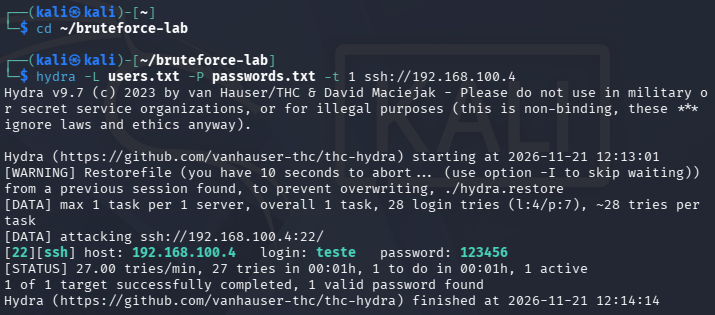
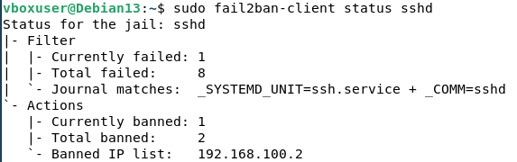
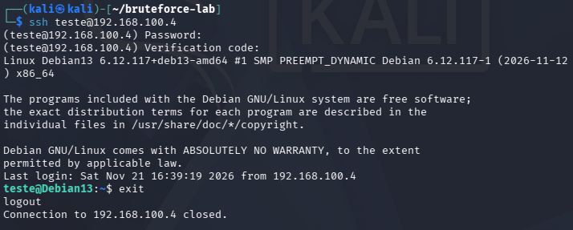
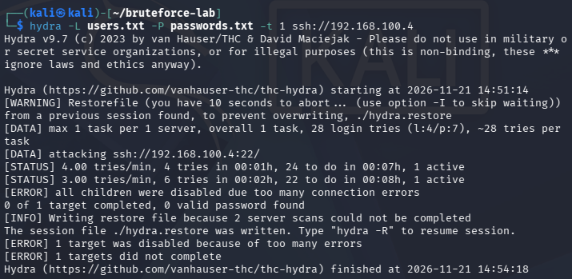

# Relatório Técnico — Simulação de Ataque de Força Bruta e Implementação de Mecanismos de Defesa

Atividade avaliativa prática sobre segurança de credenciais e mecanismos de autenticação, em ambiente de rede estritamente isolado (rede interna/*Host-Only*). O objetivo é demonstrar, sob princípios éticos, a fragilidade de credenciais fracas frente a ataques automatizados de força bruta/dicionário, bem como a eficácia de controles defensivos: bloqueio temporário de tentativas (Fail2ban) e autenticação multifator (2FA/TOTP).

## 1. Objetivo

1. Simular um ataque de força bruta/dicionário contra um serviço **SSH** com credencial fraca, utilizando o **Hydra**.
2. Implementar e validar duas contramedidas defensivas:
   - **Fail2ban** — bloqueio automático de IP após tentativas consecutivas falhas.
   - **2FA via TOTP** (Google Authenticator) — exigência de um segundo fator de autenticação.
3. Comprovar que, com as defesas ativas, o mesmo ataque automatizado deixa de ser viável.

## 2. Topologia da Rede

| Papel | Sistema | IP (Rede Interna) |
|---|---|---|
| Atacante | Kali Linux | 192.168.100.2 |
| Alvo (prova de conceito inicial) | Metasploitable (Linux) | 192.168.100.1 |
| Alvo (ataque + defesas, demonstração principal) | Debian 13 | 192.168.100.4 |

**Rede:** interna/Host-Only (`intnet`), isolada de qualquer rede de produção.

> **Observação sobre a mudança de alvo:** o ataque inicial foi validado com sucesso contra a VM Metasploitable (Ubuntu 8.04), confirmando a fragilidade da credencial de teste via SSH. Entretanto, essa distribuição é extremamente antiga (2008) e seus repositórios `universe`/`updates` já foram removidos até mesmo do arquivo histórico do Ubuntu (`old-releases.ubuntu.com`), impossibilitando a instalação do Fail2ban e do módulo PAM de TOTP. Por isso, a demonstração completa de **ataque + defesas** foi realizada em uma VM **Debian 13** recém-instalada, com repositórios ativos, mantendo a mesma credencial de teste para consistência entre os dois ambientes.

## 3. Credencial de Teste

Foi criado um usuário próprio com senha fraca e comum, para simular uma situação real de credencial mal escolhida (em vez de usar o usuário padrão já conhecido do sistema):

```bash
sudo adduser teste
# Senha definida: 123456
```

## 4. Fase 1 — Ataque de Força Bruta com Hydra

### 4.1 Preparação do SSH no alvo

**No alvo (Debian13):**
```bash
sudo apt update
sudo apt install openssh-server -y
sudo systemctl enable --now ssh
```

Confirmação de que a autenticação por senha estava habilitada:
```bash
sudo grep -i "PasswordAuthentication" /etc/ssh/sshd_config
sudo sed -i 's/#PasswordAuthentication yes/PasswordAuthentication yes/' /etc/ssh/sshd_config
sudo systemctl restart ssh
```

### 4.2 Wordlists customizadas (no Kali)

```bash
mkdir ~/bruteforce-lab
cd ~/bruteforce-lab
```

**`users.txt`:**
```
admin
root
teste
usuario
```

**`passwords.txt`:**
```
admin
123456
senha123
qwerty
teste123
123456789
password
```

### 4.3 Execução do Hydra

```bash
hydra -L users.txt -P passwords.txt -t 1 ssh://192.168.100.4
```

> **Observação técnica:** o parâmetro `-t 1` (uma tarefa por vez) foi necessário porque o OpenSSH moderno já implementa um controle de conexões simultâneas não autenticadas (`MaxStartups`), recusando conexões em paralelo em excesso — uma primeira camada de proteção que já vem ativada por padrão, antes mesmo de qualquer configuração adicional.

**Resultado:**
```
[22][ssh] host: 192.168.100.4   login: teste   password: 123456
1 of 1 target successfully completed, 1 valid password found
```



### 4.4 Observação: proteção nativa do OpenSSH (`PerSourcePenalties`)

Durante o ataque, os logs do `journalctl` revelaram que o OpenSSH recente já possui um mecanismo de penalização por origem (`PerSourcePenalties`), que passa a derrubar conexões da mesma origem após múltiplas falhas de autenticação, mesmo sem qualquer ferramenta adicional instalada:

```
error: maximum authentication attempts exceeded for invalid user admin from 192.168.100.2
PerSourcePenalties logging rate-limited: additional 25 connections dropped
drop connection #0 from [192.168.100.2]:... on [192.168.100.4]:22 penalty: failed authentication
```

## 5. Fase 2 — Defesa 1: Fail2ban

### 5.1 Instalação

**No alvo (Debian13):**
```bash
sudo apt update
sudo apt install fail2ban -y
```

### 5.2 Configuração do Jail SSH

```bash
sudo nano /etc/fail2ban/jail.local
```

```ini
[sshd]
enabled = true
port = ssh
backend = systemd
maxretry = 3
findtime = 120
bantime = 300
```

| Parâmetro | Função |
|---|---|
| `backend = systemd` | Lê os logs de autenticação diretamente do `journalctl`, já que o Debian 13 não grava mais em `/var/log/auth.log` por padrão |
| `maxretry = 3` | Bloqueia o IP após 3 tentativas de autenticação falhas |
| `findtime = 120` | Janela de tempo (segundos) em que essas tentativas precisam ocorrer para contar como ataque |
| `bantime = 300` | Duração do bloqueio (segundos) |

```bash
sudo systemctl restart fail2ban
sudo systemctl status fail2ban
```

### 5.3 Validação do Bloqueio

Nova execução do Hydra contra o alvo já protegido:
```bash
cd ~/bruteforce-lab
hydra -L users.txt -P passwords.txt -t 1 ssh://192.168.100.4
```

**Confirmação do banimento:**
```bash
sudo fail2ban-client status sshd
```

```
Status for the jail: sshd
|- Filter
|  |- Currently failed: 1
|  |- Total failed:     8
|  `- Journal matches:  _SYSTEMD_UNIT=ssh.service + _COMM=sshd
`- Actions
   |- Currently banned:  1
   |- Total banned:      2
   `- Banned IP list:    192.168.100.2
```



**Tentativa de login manual durante o bloqueio** (mesmo com a senha correta):
```bash
ssh teste@192.168.100.4
```
```
ssh: connect to host 192.168.100.4 port 22: Connection refused
```

## 6. Fase 3 — Defesa 2: Autenticação de Dois Fatores (2FA / TOTP)

### 6.1 Instalação do Módulo PAM

**No alvo (Debian13):**
```bash
sudo apt install libpam-google-authenticator -y
```

### 6.2 Geração do Segredo TOTP para o Usuário de Teste

```bash
su - teste
google-authenticator
```

Respostas no assistente interativo:
- Tokens baseados em tempo: **y**
- Atualizar `.google_authenticator`: **y**
- Impedir reutilização de código: **y**
- Aumentar a janela de geração original: **n**
- Habilitar rate-limiting: **y**

O QR Code gerado foi escaneado com um aplicativo autenticador (Google Authenticator) no celular.

### 6.3 Configuração do PAM para o SSH

```bash
sudo nano /etc/pam.d/sshd
```

Linha adicionada ao final do arquivo:
```
auth required pam_google_authenticator.so
```

### 6.4 Configuração do `sshd_config`

```bash
sudo nano /etc/ssh/sshd_config
```

```
KbdInteractiveAuthentication yes
UsePAM yes
PasswordAuthentication no
```

```bash
sudo systemctl restart ssh
```

> Com `PasswordAuthentication no`, o SSH passa a exigir o fluxo `keyboard-interactive`, controlado pelo PAM — que solicita a senha (via `pam_unix`, através do `@include common-auth`) e, em seguida, o código TOTP (via `pam_google_authenticator`), caracterizando a autenticação em duas etapas.

### 6.5 Validação do Login com 2FA

```bash
ssh teste@192.168.100.4
```

```
(teste@192.168.100.4) Password:
(teste@192.168.100.4) Verification code:
...
Last login: Sat Nov 21 14:06:21 2026 from 192.168.100.2
teste@Debian13:~$
```



## 7. Fase 4 — Validação Final: Ataque Contra o Ambiente Totalmente Protegido

Com o Fail2ban e o 2FA ativos simultaneamente, o Hydra foi executado uma última vez contra o alvo, incluindo a senha correta na wordlist:

```bash
sudo fail2ban-client set sshd unbanip 192.168.100.2   # executado no console da VM Debian13
cd ~/bruteforce-lab
hydra -L users.txt -P passwords.txt -t 1 ssh://192.168.100.4
```

**Resultado:**
```
0 of 1 target completed, 0 valid password found
```



Mesmo com a credencial correta disponível na wordlist, o ataque automatizado **não conseguiu completar nenhum login**: o Hydra não tem como gerar o código TOTP (que muda a cada 30 segundos e depende de um segredo privado), e eventuais tentativas repetidas acionam novamente o bloqueio do Fail2ban.

## 8. Propostas de Mitigação

| Vulnerabilidade | Mitigação |
|---|---|
| Senhas fracas/previsíveis | Políticas de senha forte (comprimento mínimo, complexidade), verificação contra listas de senhas vazadas |
| Tentativas de login ilimitadas | Fail2ban (ou soluções equivalentes), limitação de taxa (*rate limiting*) na aplicação |
| Autenticação de fator único | 2FA/MFA obrigatório para todos os acessos administrativos e remotos |
| Ataques distribuídos (múltiplos IPs) | Complementar com serviços de reputação de IP, WAF, ou acesso via VPN/bastion host |

## 9. Conclusão

A atividade demonstrou, na prática, como uma credencial fraca pode ser descoberta em segundos por uma ferramenta automatizada de força bruta, mesmo contra um serviço corretamente configurado. Em contrapartida, a implementação combinada de **Fail2ban** (bloqueio por tentativas) e **2FA via TOTP** (exigência de um segundo fator) tornou o mesmo ataque completamente inviável — não só impedindo a continuidade das tentativas através do banimento de IP, como eliminando por completo a utilidade de uma senha comprometida, já que o atacante não possui o segundo fator de autenticação.

---

> Atividade avaliativa realizada em ambiente estritamente isolado (rede interna *Host-Only*), sob princípios éticos e regulatórios, exclusivamente para fins acadêmicos.
